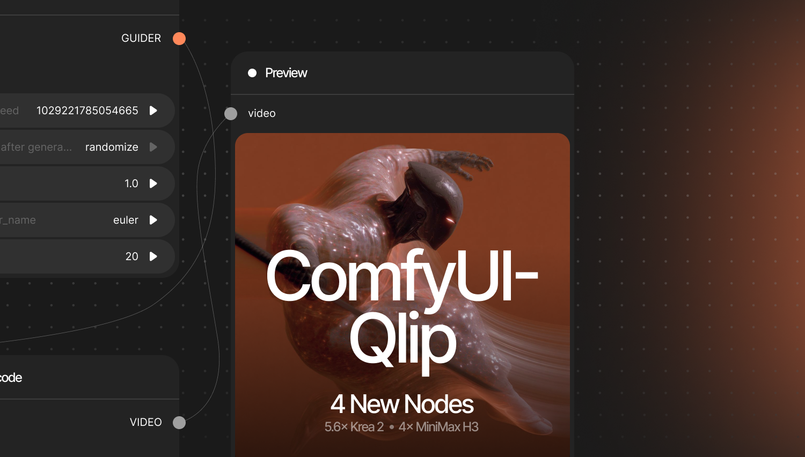
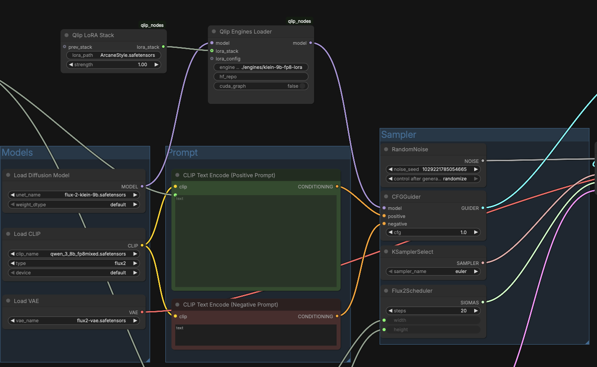

# ComfyUI-Qlip

<p align="center">
  
</p>

**Make diffusion models in ComfyUI 2–5× faster. Keep your workflow, keep your image.**

ComfyUI-Qlip adds a few nodes to an existing ComfyUI workflow and runs the model's transformer
on optimized engines (FP8, NVFP4, FP4 attention) or speeds it up on the fly. Your sampler, your
LoRAs and your prompts stay the same. It is powered by [Qlip](https://thestage.ai) from
TheStage AI.

| FLUX.2 Klein 9B — Baseline (BF16, 10.1 s) | FLUX.2 Klein 9B — Qlip (NVFP4 + FP4-attn, 2.8 s, **3.6×**) |
|---|---|
|  |  |
| **Z-Image-Turbo 6B — Baseline (eager, 2.3 s)** | **Z-Image-Turbo 6B — Qlip (NVFP4 + FP4-attn, 0.9 s, 2.6×)** |
|  |  |

Both pairs were measured on an RTX 5090.

## Why ComfyUI-Qlip

- **Drop-in.** Add one node between the model loader and the sampler. Any sampler works.
- **Fast on the GPUs you have.** Engines for H100 / H200, RTX 5090 and B200, including NVFP4 and
  FP4 attention on Blackwell.
- **LoRA without recompiling.** LoRA is a runtime input: switch or stack LoRAs between runs.
- **Works on brand-new models.** The acceleration nodes need no precompiled engine, so they work on
  a model released yesterday.
- **Stackable.** Engines, caching, progressive resolution and sparse attention combine.

## Speedups at a glance

| Model | GPU | Speedup vs eager | How |
|---|---|---|---|
| Krea 2 Turbo | RTX 5090 | **5.58×** | acceleration nodes |
| Z-Image-Turbo 6B | RTX 5090 | **5.09×** | acceleration nodes |
| MiniMax H3 (video + audio) | RTX 5090 | **4.02×** | acceleration nodes |
| FLUX.2 Klein 9B (edit) | RTX 5090 | **3.61×** | engine, NVFP4 + FP4 attention |
| Krea 2 Turbo | H200 | **2.70×** | engine FP8 + `QlipCache` + `QlipProgressive` |
| Wan 2.2 I2V 14B | RTX 5090 | **2.1×** | engine NVFP4 + FP4 attention, single expert |
| LTX-Video 2.3 22B | H100 | **1.78×** | engine FP8 |

Setups and the full tables: [Benchmarks](docs/benchmarks.md).

## Quick start

You need an NVIDIA GPU (Hopper / Ada, or Blackwell RTX 5090 / B200), Python 3.10+ (**3.11+ on
Blackwell**) and a TheStage token from [app.thestage.ai](https://app.thestage.ai).

```bash
git clone https://github.com/comfyanonymous/ComfyUI.git
cd ComfyUI
git checkout b615af1c        # the commit your engines need, see docs/installation.md
python3 -m venv venv && source venv/bin/activate

git clone https://github.com/TheStageAI/ComfyUI-Qlip custom_nodes/ComfyUI-Qlip
python custom_nodes/ComfyUI-Qlip/install.py              # detects your GPU, installs everything
thestage config set --access-token <YOUR_API_TOKEN>

python main.py --listen 0.0.0.0 --port 8188
```

Then open a workflow from [`workflows/`](workflows/), for example `z-image-turbo-5090.json` on an
RTX 5090, and press **Queue**. The engine downloads on the first run.

> Do not run ComfyUI's own `pip install -r requirements.txt` yourself: on Blackwell it replaces the
> CUDA 13 torch the engines need. `install.py` installs it with torch pinned.

Already have ComfyUI, need another commit, or want to install by hand? See
[Installation](docs/installation.md).

## Two ways to accelerate

### 1. Precompiled engine: the fastest path for supported models

Add **Qlip Engines Loader** to the model line and set `hf_repo` to the engine for your GPU:

```
UNETLoader → Qlip Engines Loader (hf_repo = TheStageAI/Elastic-Z-Image-Turbo:models/GeForce-RTX-5090/z-image-turbo-nvfp4_lora) → sampler
```

The loader downloads the engine once and swaps it in for the model's transformer blocks. Add
**Qlip LoRA Stack** for LoRAs. All engines: [Supported models and engines](docs/models.md).

<p align="center">
  
  <br>
  <em>FLUX.2 Klein 9B with LoRA: Qlip Engines Loader and Qlip LoRA Stack added to an existing
  workflow. The rest of the graph is unchanged.</em>
</p>

### 2. Acceleration nodes: any model, no engine needed

Put these on the `MODEL` line, in this order. Each has an `enable` switch.

```
model → QlipAutoSparse → QlipCompile → QlipCache → QlipProgressive → sampler
```

| Node | Speeds up by | Best for |
|---|---|---|
| **QlipCompile** | compiling the blocks in-process, optional FP8 / NVFP4 | any model |
| **QlipCache** | skipping denoising steps the model would barely change | 20–50-step base models |
| **QlipProgressive** | running early steps at lower resolution | high-resolution images |
| **QlipAutoSparse** | skipping attention blocks that matter least | video, long sequences |

Combining two of them usually gives the best result. All nodes and their parameters:
[Nodes](docs/nodes.md). To search combinations automatically, give a coding agent
[`AGENTS.md`](AGENTS.md): see [QLIP Agent](docs/qlip-agent.md).

## Supported models

| Model | Type | Engines |
|---|---|---|
| FLUX.2 Klein 9B | Image, image edit | H100, RTX 5090, B200 |
| Z-Image-Turbo 6B | Image | H100, RTX 5090, B200 |
| Krea 2 Turbo | Image | H200 |
| Qwen Image Edit 14B | Image edit | H100 |
| Wan 2.2 I2V 14B | Video (image-to-video) | H100, RTX 5090 |
| LTX-Video 2 19B | Video + audio (image-to-video) | H100 |
| LTX-Video 2.3 22B | Video + audio (text-to-video) | H100 |

Other DiT models work with the acceleration nodes. To build engines for a new model or GPU, see
[Compile your own model](docs/compile-your-own-model.md).

## Documentation

| Page | What is in it |
|---|---|
| [Installation](docs/installation.md) | ComfyUI commits per model, `install.py`, manual install, FP4-attention plugin |
| [Supported models and engines](docs/models.md) | Model details, every `hf_repo` value, manual engine download |
| [Workflows and model downloads](docs/workflows.md) | Ready-to-use workflows, model download scripts, graph patterns |
| [Nodes](docs/nodes.md) | Choosing an acceleration, every node parameter, LoRA with engines |
| [Benchmarks](docs/benchmarks.md) | H100 / H200 / RTX 5090 / B200 results and comparisons |
| [QLIP Agent](docs/qlip-agent.md) | Automatic search for the best speed/quality config |
| [Compile your own model](docs/compile-your-own-model.md) | Engines for new models, GPUs or resolutions |
| [Troubleshooting](docs/troubleshooting.md) | Common errors and fixes |
| [Changelog](docs/changelog.md) | What changed in each release |

## Free credits

New users get **10 free credits** at [app.thestage.ai](https://app.thestage.ai).

## License

Proprietary. Powered by [TheStage AI](https://thestage.ai).
